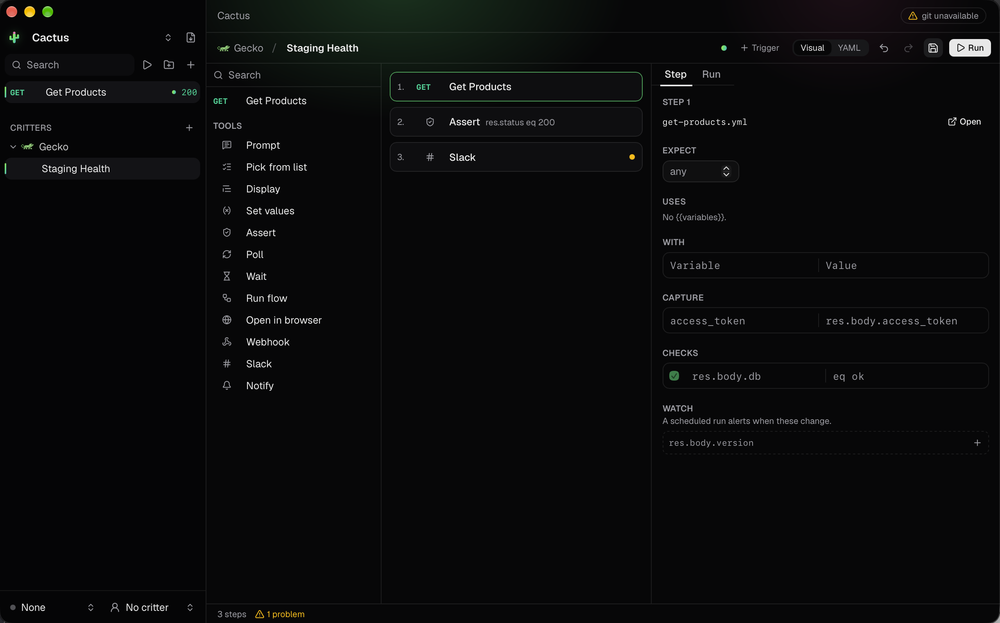

A flow is a list of steps a bot runs in order. Each step is a request from the project or a tool, such as prompt, pick, poll or Slack.



Flows live at `critters/<critter>/flows/<flow>.yml`. The file name is the flow's id. Changes in the editor and in the file are the same thing.

## Request steps

```yaml
steps:
  - request: auth/login.yml
  - request: orders/create.yml
    with:                     # variables for this step only
      sku: TSHIRT-M
    capture:                  # saved to the bot's context
      orderId: res.body.id
    expect: 201               # replaces the request's status checks
    assert:                   # added after the request's own checks
      - expression: res.body.status
        operator: eq
        value: pending
    watch:                    # compared between scheduled runs
      - res.body.priceVersion
```

None of these change the request file.

## Tool steps

```yaml title="critters/support/flows/refund.yml"
name: Refund an order
steps:
  - tool: prompt
    vars:
      - name: email
        label: Customer email
  - request: customers/find.yml
    capture:
      orders: res.body.orders
  - tool: pick
    title: Which order?
    list: "{{orders}}"
    label: number
    set:
      orderId: id
      amount: total
  - tool: display
    title: Refund {{amount}}?
    pause: true
  - request: orders/refund.yml
    expect: 200
```

| Tool | |
| --- | --- |
| [`prompt`](/reference/flow-tools/#prompt) | Ask for values |
| [`pick`](/reference/flow-tools/#pick) | Choose an item from a list |
| [`display`](/reference/flow-tools/#display) | Show a message; optionally wait for Continue |
| [`set`](/reference/flow-tools/#set) | Set variables, e.g. `$uuid` |
| [`assert`](/reference/flow-tools/#assert) | Check variables |
| [`poll`](/reference/flow-tools/#poll) | Repeat a request until its checks pass |
| [`wait`](/reference/flow-tools/#wait) | Pause |
| [`run`](/reference/flow-tools/#run) | Run another flow |
| [`open`](/reference/flow-tools/#open) | Open a URL in the browser |
| [`webhook`](/reference/flow-tools/#webhook) | Send any HTTP request |
| [`slack`](/reference/flow-tools/#slack) | Post to a Slack webhook |
| [`notify`](/reference/flow-tools/#notify) | Show a desktop notification |

## Values between steps

| Set by | Lasts |
| --- | --- |
| `capture`, and set-variable actions in the request | Saved to the bot's context |
| `prompt`, `pick`, `set`, `poll` | The current run only, never written to disk |

The editor shows which variables pass between steps, and lists any step that uses a variable nothing has set.

## Running

- **App**: **Run**. Each step shows its request and response. A failed step skips the rest of the flow.
- **CLI**: `cactus-cli flow . support refund --var email=jo@example.com`. See [CLI](/reference/cli/#flow).
- **Schedule**: see [Schedules and alerts](/guides/schedules/).
- **Agent**: see [AI agents](/guides/mcp/).

## Reusing flows

```yaml
- tool: run
  flow: seed-data
- tool: run
  flow: login
  critter: admin
```

Flows can call each other up to 8 levels deep.
